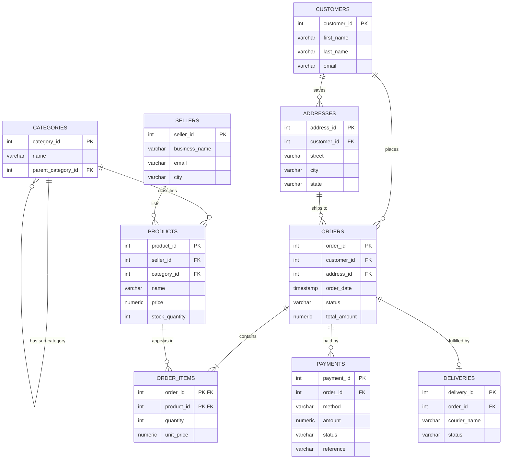
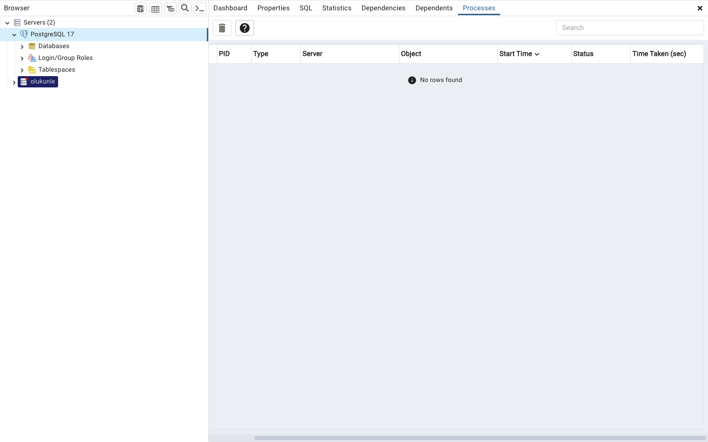

# Portfolio 1: Database Design and Modelling

## 1. Case Study: ShopBeta

**Organisation:** ShopBeta, a simulated multi-seller online marketplace based in Lagos, Nigeria.

**Nature of the business:** Independent sellers list products (electronics, fashion, home items) and customers buy them online. ShopBeta takes payment and arranges delivery through courier partners.

**Users of the database:** customers, sellers, delivery staff, and administrators.

**Major data stored:** products, categories, sellers, customers and their addresses, orders and order items, payments, and delivery records.

**Key operations supported:**
- Add and update products
- Place an order
- Update stock after a sale
- Process payment
- Track delivery
- Report on sales by seller, category and period

## 2. Entity-Relationship Diagram

> GitHub renders the diagram above automatically. A screenshot of the same diagram generated in pgAdmin is in `screenshots/`.

## 3. Relational Schema

The full DDL is in [`schema.sql`](schema.sql). Summary:

| Table | Primary Key | Foreign Keys |
|---|---|---|
| categories | category_id | parent_category_id → categories |
| sellers | seller_id | none |
| customers | customer_id | none |
| addresses | address_id | customer_id → customers |
| products | product_id | seller_id → sellers, category_id → categories |
| orders | order_id | customer_id → customers, address_id → addresses |
| order_items | (order_id, product_id) | order_id → orders, product_id → products |
| payments | payment_id | order_id → orders |
| deliveries | delivery_id | order_id → orders (UNIQUE) |

## 4. Keys and Constraints

**Primary keys:** each table uses a surrogate `SERIAL` key, except `order_items`, which uses a composite key (order_id, product_id) because a product can appear only once per order.

**Foreign keys:** enforce referential integrity. For example, an order cannot reference a customer that does not exist. `ON DELETE CASCADE` is used where child rows have no meaning without the parent (addresses, order_items). It is deliberately not used for products, so a product with sales history cannot be deleted.

**UNIQUE:** customer, seller and category names/emails, payment `reference`, and `deliveries.order_id` (one delivery per order).

**CHECK constraints:**
- `price >= 0`, `stock_quantity >= 0`: stock can never go negative
- `quantity > 0` on order items
- `status` columns limited to defined values
- delivery date cannot be before shipping date

**NOT NULL and DEFAULT:** mandatory fields are `NOT NULL`. Defaults such as `status = 'PENDING'` and `CURRENT_TIMESTAMP` keep inserts simple.

## 5. Normalisation

### Starting point (unnormalised)
Imagine all order data kept in a single sheet:

| order_id | customer_name | customer_email | customer_address | products | quantities | seller | total |
|---|---|---|---|---|---|---|---|
| 1001 | Ada Obi | ada@mail.com | 12 Ikeja Rd | Phone, Case | 1, 2 | TechHub, GadgetPlus | 215000 |

Problems: repeating groups in one cell, customer details repeated for every order, and update, insert and delete anomalies.

### First Normal Form (1NF)
Remove repeating groups so every cell holds a single value. Each product on an order becomes its own row, identified by (order_id, product_id).

### Second Normal Form (2NF)
Remove partial dependencies. With key (order_id, product_id), `customer_name` depends only on `order_id`, and `product_name` and `seller` depend only on `product_id`. These attributes move into separate `orders` and `products` tables. Only `quantity` and `unit_price` depend on the full composite key, so they stay in `order_items`.

### Third Normal Form (3NF)
Remove transitive dependencies. In `orders`, customer name and email depend on `customer_id`, not on `order_id`, so they move to `customers`. In `products`, the seller's business details depend on `seller_id`, so they live in `sellers`. Addresses become their own table because a customer can have several.

### Result
All nine tables are in 3NF: every non-key attribute depends on the key, the whole key, and nothing but the key.

### Deliberate design decisions
- **`unit_price` in `order_items`** looks like duplication of `products.price`, but it is a historical snapshot. If a price changes later, past orders must keep the price the customer actually paid. It is not a normalisation violation.
- **`orders.total_amount`** can be derived from the order items, so it is controlled denormalisation. It is kept for faster reporting and is set inside the order transaction (see Portfolio 3), so it stays consistent.

## 6. How to Reproduce
1. PostgreSQL 17 installed locally and connected through pgAdmin:.
2. Create a database: `CREATE DATABASE shopbeta;`
3. Open the Query Tool on `shopbeta`, load `schema.sql`, and run it.
4. In pgAdmin, right-click the database → **ERD For Database** to generate the diagram.

## 7. Evidence
- [ ] Screenshot: tables created in pgAdmin
- [ ] Screenshot: ERD generated by pgAdmin
- [ ] Screenshot: a failed insert that violates a CHECK constraint (for example, negative stock)
