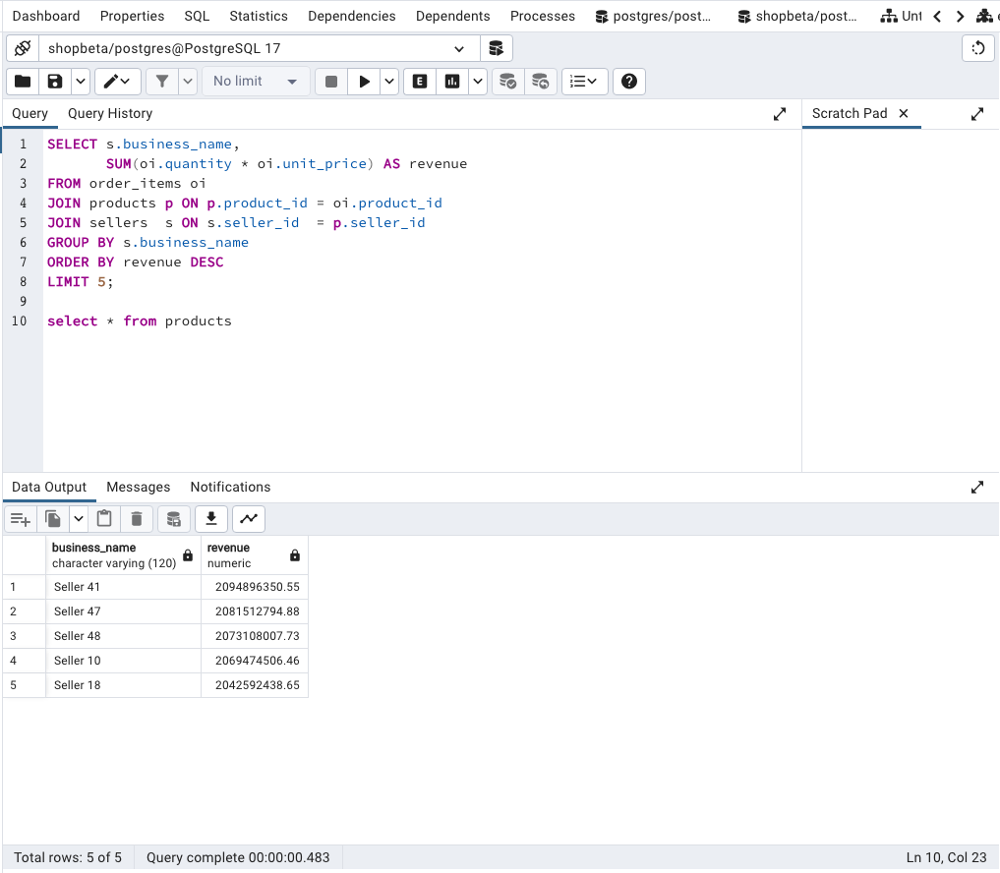
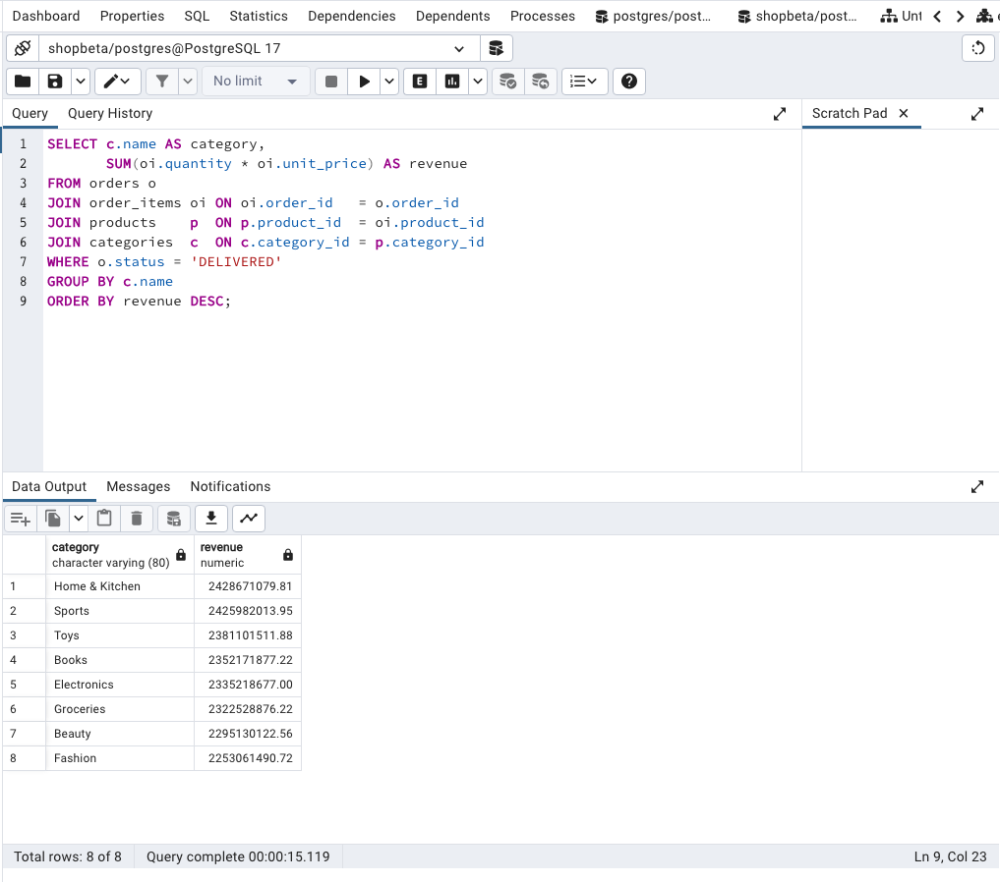

# Portfolio 2: Query Processing and Optimisation

## 1. Purpose
This portfolio tests how queries run on the ShopBeta database when it holds a realistic amount of data, and how indexes change query performance.

## 2. Data used
The tables were filled with synthetic (made-up) data using `generate_data.sql`:

| Table | Rows |
|---|---|
| categories | 8 |
| sellers | 50 |
| customers | 20000 |
| addresses | 20000 |
| products | 5000 |
| orders | 200000 |
| order_items | 400001 |
| payments | 120216 |
| deliveries | 79824 |


## 3. Business queries
The queries are in `queries.sql` (Part A).

### A1: Orders in each status
This SQL query counts the total number of orders for each status in the orders table and ranks them from most to least frequent.


### A2: Top 5 sellers by revenue
Calculates total sales revenue for each seller by joining the order_items, products, and sellers tables, returning the top 5 highest-grossing businesses.



### A3: Revenue per category (delivered orders)
Calculates total revenue generated by product category for delivered orders, ranked from highest to lowest.



## 4. Execution plans and indexing

### B1: Orders for one customer
```sql
SELECT * FROM orders WHERE customer_id = 500;
```

**Before the index:**

Execution Plan: Parallel Sequential Scan (Parallel Seq Scan)

Execution Time: 83.87 ms

Query Plan Summary:Gather  (cost=1000.00..5500.67 rows=10 width=36) (actual time=60.429..83.842 rows=10 loops=1)
  Workers Planned: 2
  Workers Launched: 2
  Buffers: shared hit=3458
  ->  Parallel Seq Scan on orders  (cost=0.00..4499.67 rows=4 width=36) (actual time=20.365..45.748 rows=3 loops=3)
        Filter: (customer_id = 500)
        Rows Removed by Filter: 66663
        Buffers: shared hit=3458
Planning:
  Buffers: shared hit=6
Planning Time: 0.226 ms
Execution Time: 83.867 ms


**Index created:**
```sql
CREATE INDEX idx_orders_customer_id ON orders(customer_id);
```

**After the index:** 

Execution Plan: Bitmap Index Scan (Bitmap Heap Scan)

Execution Time: 0.13 ms

Query Plan Summary:Bitmap Heap Scan on orders  (cost=4.37..42.88 rows=10 width=36) (actual time=0.069..0.088 rows=10 loops=1)
  Recheck Cond: (customer_id = 500)
  Heap Blocks: exact=10
  Buffers: shared hit=10 read=2
  ->  Bitmap Index Scan on idx_orders_customer_id  (cost=0.00..4.37 rows=10 width=0) (actual time=0.055..0.055 rows=10 loops=1)
        Index Cond: (customer_id = 500)
        Buffers: shared read=2
Planning:
  Buffers: shared hit=16 read=1
Planning Time: 0.435 ms
Execution Time: 0.134 ms

**Analysis:** Without an index, Postgres had to do a Seq Scan (Sequential Scan), meaning it checked every single row in the orders table just to find the 10 orders belonging to customer 500. After adding the index, Postgres used a Bitmap Index Scan to look up the exact locations of customer 500's orders first and grab only those rows. This dropped the execution time from 83.87 ms to 0.13 ms.

### B2: Delivered orders in the last 30 days
```sql
SELECT COUNT(*), SUM(total_amount)
FROM orders
WHERE status = 'DELIVERED' 
  AND order_date >= NOW() - INTERVAL '30 days';
```

**Before the index:**

Execution Plan: Parallel Sequential Scan (Parallel Seq Scan)

Execution Time: 132.32 ms

Query Plan Summary:Finalize Aggregate  (cost=6127.64..6127.65 rows=1 width=40) (actual time=125.049..129.190 rows=1 loops=1)
  Buffers: shared hit=3458
  ->  Gather  (cost=6127.41..6127.62 rows=2 width=40) (actual time=124.921..129.173 rows=3 loops=1)
        Workers Planned: 2
        Workers Launched: 2
        Buffers: shared hit=3458
        ->  Partial Aggregate  (cost=5127.41..5127.42 rows=1 width=40) (actual time=57.463..57.464 rows=1 loops=3)
              Buffers: shared hit=3458
              ->  Parallel Seq Scan on orders  (cost=0.00..5124.67 rows=548 width=8) (actual time=21.370..57.203 rows=424 loops=3)
                    Filter: (((status)::text = 'DELIVERED'::text) AND (order_date >= (now() - '30 days'::interval)))
                    Rows Removed by Filter: 66242
                    Buffers: shared hit=3458
Planning:
  Buffers: shared hit=6 dirtied=1
Planning Time: 0.378 ms
Execution Time: 132.317 ms


**Index created:**
```sql
CREATE INDEX idx_orders_status_date ON orders(status, order_date);
ANALYZE orders;
```

**After the index:** 

Execution Plan: Bitmap Index Scan (Bitmap Heap Scan)

Execution Time: 2.83 ms

Query Plan Summary:```Aggregate  (cost=2564.98..2564.99 rows=1 width=40) (actual time=2.773..2.775 rows=1 loops=1)
  Buffers: shared hit=918 read=9
  ->  Bitmap Heap Scan on orders  (cost=37.41..2558.65 rows=1267 width=8) (actual time=1.552..2.467 rows=1272 loops=1)
        Recheck Cond: (((status)::text = 'DELIVERED'::text) AND (order_date >= (now() - '30 days'::interval)))
        Heap Blocks: exact=918
        Buffers: shared hit=918 read=9
        ->  Bitmap Index Scan on idx_orders_status_date  (cost=0.00..37.09 rows=1267 width=0) (actual time=1.431..1.431 rows=1272 loops=1)
              Index Cond: (((status)::text = 'DELIVERED'::text) AND (order_date >= (now() - '30 days'::interval)))
              Buffers: shared read=9
Planning:
  Buffers: shared hit=28 read=1
Planning Time: 3.202 ms
Execution Time: 2.827 ms```

**Analysis:** Before the index, Postgres ran a Seq Scan across the whole orders table to check which orders were both 'DELIVERED' and placed in the last 30 days. Creating a composite index on (status, order_date) let Postgres use a Bitmap Index Scan to skip all unneeded rows and pull only the matching data. This brought the query time down from 132.32 ms to 2.83 m

### B3: Orders and customers for one product
```sql
SELECT o.order_id, o.order_date, c.first_name, c.last_name, oi.quantity
FROM order_items oi
JOIN orders    o ON o.order_id    = oi.order_id
JOIN customers c ON c.customer_id = o.customer_id
WHERE oi.product_id = 123;
```

**Before the index:**

Execution Plan: Parallel Sequential Scan (Parallel Seq Scan) on order_items

Execution Time: 1199.66 ms

Query Plan Summary:```Gather (cost=1000.71..6903.65 rows=80 width=27) (actual time=35.033..1199.093 rows=80 loops=1)
  Workers Planned: 1
  Workers Launched: 1
  Buffers: shared hit=3110
  ->  Nested Loop  (cost=0.71..5895.65 rows=47 width=27) (actual time=31.845..1169.670 rows=40 loops=2)
        Buffers: shared hit=3110
        ->  Nested Loop  (cost=0.42..5881.05 rows=47 width=20) (actual time=22.377..934.815 rows=40 loops=2)
              Buffers: shared hit=2869
              ->  Parallel Seq Scan on order_items oi  (cost=0.00..5489.18 rows=47 width=8) (actual time=17.747..612.113 rows=40 loops=2)
                    Filter: (product_id = 123)
                    Rows Removed by Filter: 199960
                    Buffers: shared hit=2548
              ->  Index Scan using orders_pkey on orders o  (cost=0.42..8.34 rows=1 width=16) (actual time=8.052..8.052 rows=1 loops=80)
                    Index Cond: (order_id = oi.order_id)
                    Buffers: shared hit=321
        ->  Index Scan using customers_pkey on customers c  (cost=0.29..0.31 rows=1 width=15) (actual time=5.861..5.861 rows=1 loops=80)
              Index Cond: (customer_id = o.customer_id)
              Buffers: shared hit=241
Planning:
  Buffers: shared hit=79 read=2 dirtied=3
Planning Time: 20.193 ms
Execution Time: 1199.658 ms ```

**Index created:**
```sql
CREATE INDEX idx_order_items_product_id ON order_items(product_id);
ANALYZE order_items;
```

**After the index:** 

Execution Plan: Bitmap Index Scan (Bitmap Heap Scan) on order_items

Execution Time: 18.82 ms

Query Plan Summary:```Nested Loop  (cost=5.75..972.17 rows=80 width=27) (actual time=0.337..18.690 rows=80 loops=1)
  Buffers: shared hit=640 read=3
  ->  Nested Loop  (cost=5.46..947.31 rows=80 width=20) (actual time=0.255..11.072 rows=80 loops=1)
        Buffers: shared hit=400 read=3
        ->  Bitmap Heap Scan on order_items oi  (cost=5.04..280.31 rows=80 width=8) (actual time=0.167..0.387 rows=80 loops=1)
              Recheck Cond: (product_id = 123)
              Heap Blocks: exact=80
              Buffers: shared hit=80 read=3
              ->  Bitmap Index Scan on idx_order_items_product_id  (cost=0.00..5.02 rows=80 width=0) (actual time=0.144..0.144 rows=80 loops=1)
                    Index Cond: (product_id = 123)
                    Buffers: shared read=3
        ->  Index Scan using orders_pkey on orders o  (cost=0.42..8.34 rows=1 width=16) (actual time=0.130..0.130 rows=1 loops=80)
              Index Cond: (order_id = oi.order_id)
              Buffers: shared hit=320
  ->  Index Scan using customers_pkey on customers c  (cost=0.29..0.31 rows=1 width=15) (actual time=0.091..0.091 rows=1 loops=80)
        Index Cond: (customer_id = o.customer_id)
        Buffers: shared hit=240
Planning:
  Buffers: shared hit=55 read=1
Planning Time: 1.937 ms
Execution Time: 18.818 ms ```

**Analysis:** Before indexing, Postgres did a Seq Scan on order_items, reading all of its roughly 400,000 rows to locate product 123, which took over 1 second. With the index on product_id, Postgres ran a Bitmap Index Scan to pinpoint just the 80 matching items directly before joining them to orders. This cut the execution time from 1,199.66 ms down to 18.82 ms.

## 5. Performance summary

| Query | Before (ms) | After (ms) | Index used |
|---|---|---|---|
| B1: orders for one customer | 83.87 | 0.13 | idx_orders_customer_id |
| B2: delivered orders, last 30 days | 132.32 | 2.83 | idx_orders_status_date |
| B3: customers who bought product 123 | 1199.66 | 18.82 | idx_order_items_product_id |

## 6. Conclusion
Indexes significantly boost read performance by allowing PostgreSQL to locate specific rows directly without performing costly sequential table scans. However, they come with a clear trade-off: each index consumes extra disk space and slows down write operations like INSERT, UPDATE, and DELETE because the database must update the index structure alongside the table. Consequently, indexes should be created strategically based on frequent query filter patterns rather than applied indiscriminately.
