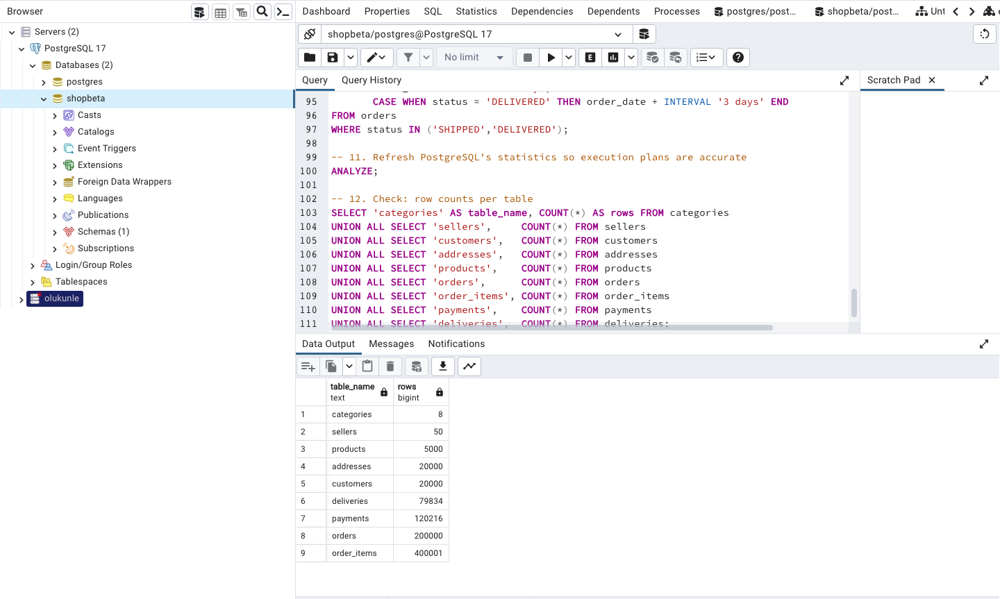
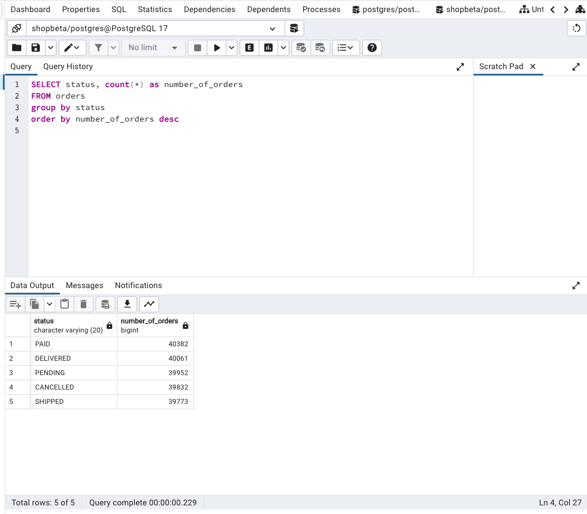

# Portfolio 2: Query Processing and Optimisation

## 1. Purpose
This portfolio tests how queries run on the ShopBeta database when it holds a realistic amount of data, and how indexes change query performance.

## 2. Data used
The tables were filled with synthetic (made-up) data using `generate_data.sql`:

| Table | Rows |
|---|---|
| categories | [your count] |
| sellers | [your count] |
| customers | [your count] |
| addresses | [your count] |
| products | [your count] |
| orders | [your count] |
| order_items | [your count] |
| payments | [your count] |
| deliveries | [your count] |



## 3. Business queries
The queries are in `queries.sql` (Part A).

### A1: Orders in each status
This SQL query counts the total number of orders for each status in the orders table and ranks them from most to least frequent.



### A2: Top 5 sellers by revenue
Calculates total sales revenue for each seller by joining the order_items, products, and sellers tables, returning the top 5 highest-grossing businesses.


### A3: Revenue per category (delivered orders)
[One sentence on what the query does.]


## 4. Execution plans and indexing

### B1: Orders for one customer
```sql
SELECT * FROM orders WHERE customer_id = 500;
```

**Before the index:** the plan used [Seq Scan / Index Scan]. Execution time: [your ms].


**Index created:**
```sql
CREATE INDEX idx_orders_customer_id ON orders(customer_id);
```

**After the index:** the plan used [Seq Scan / Index Scan]. Execution time: [your ms].


**Analysis:** [Write in your own words why the time changed.]

### B2 and B3
[Add these in the same format once you have run them.]

## 5. Performance summary

| Query | Before (ms) | After (ms) | Index used |
|---|---|---|---|
| B1: orders for one customer | [ ] | [ ] | idx_orders_customer_id |
| B2: delivered orders, last 30 days | [ ] | [ ] | idx_orders_status_date |
| B3: customers who bought product 123 | [ ] | [ ] | idx_order_items_product_id |

## 6. Conclusion
[Two or three sentences: what you learned about indexes, and the trade-off. Indexes speed up reading but take extra storage and slow down inserts and updates.]
