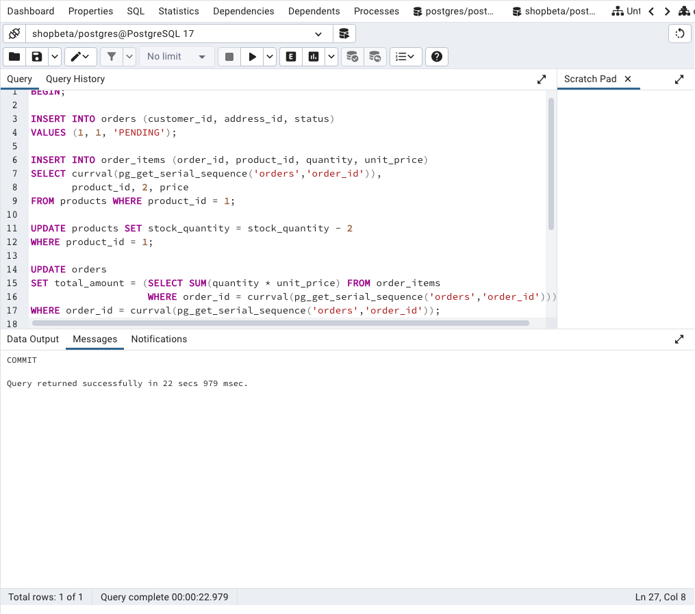
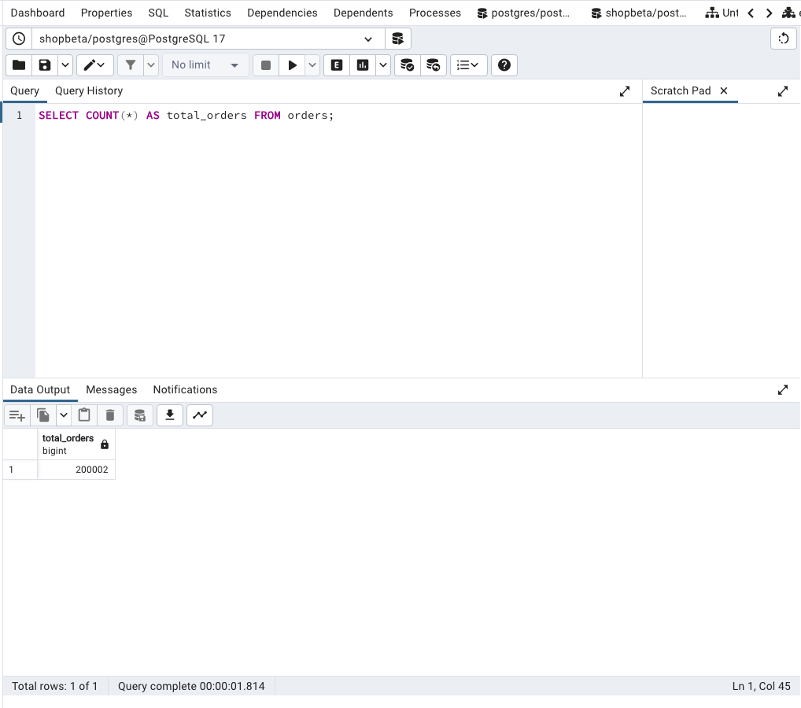
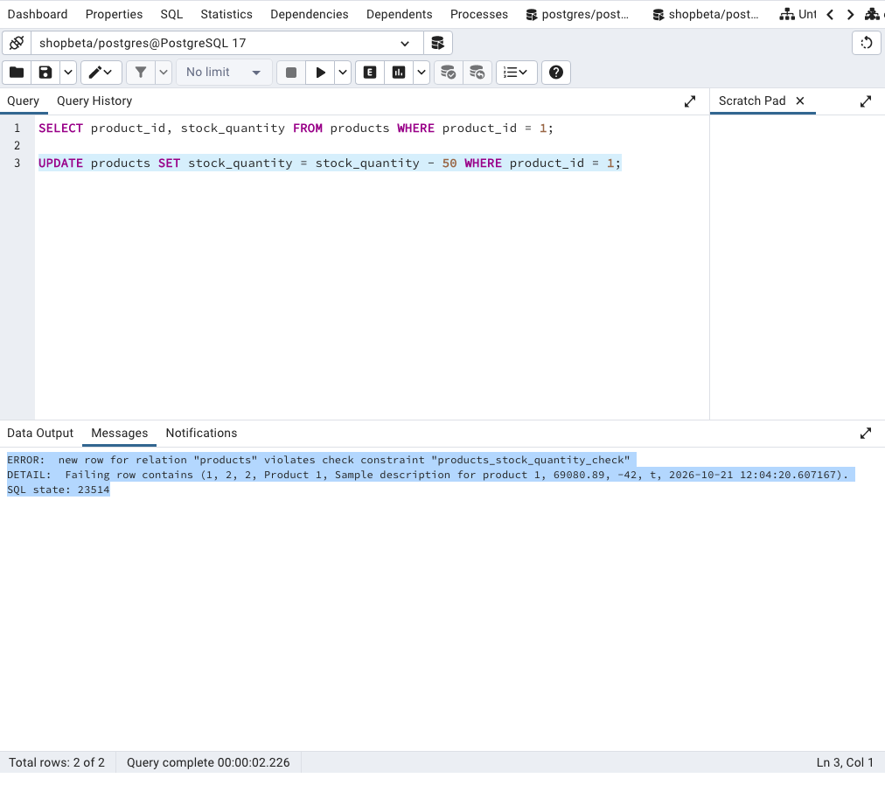
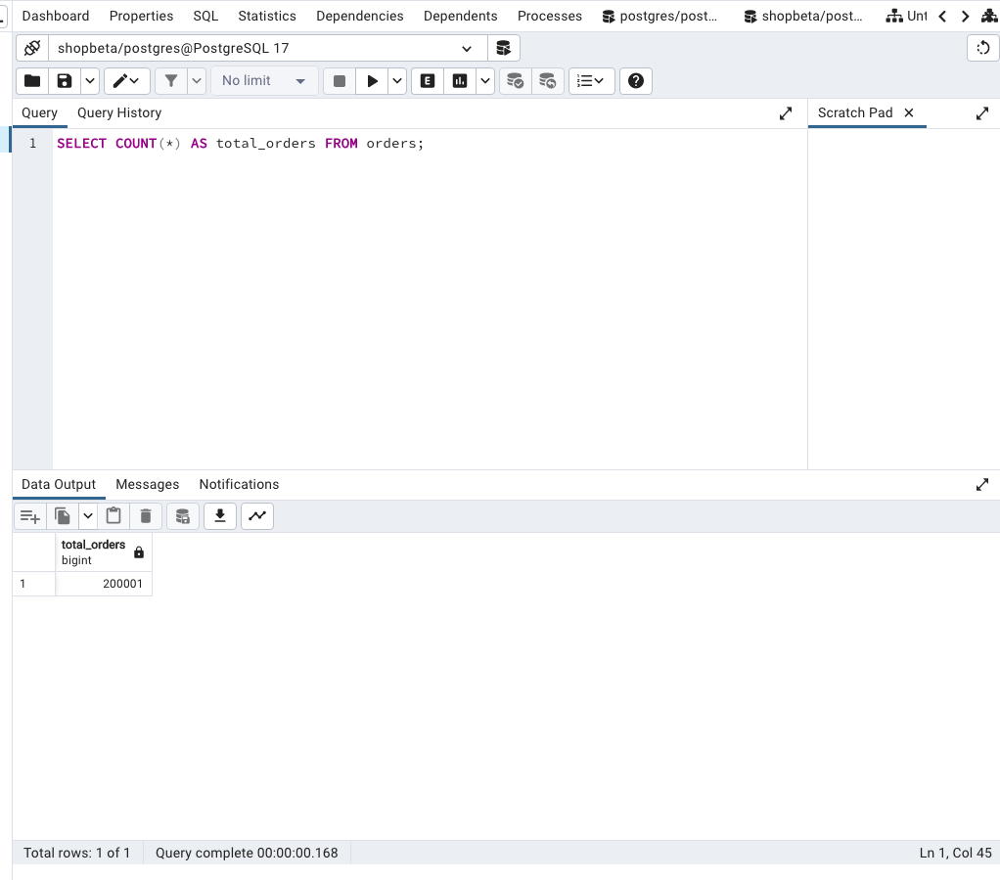
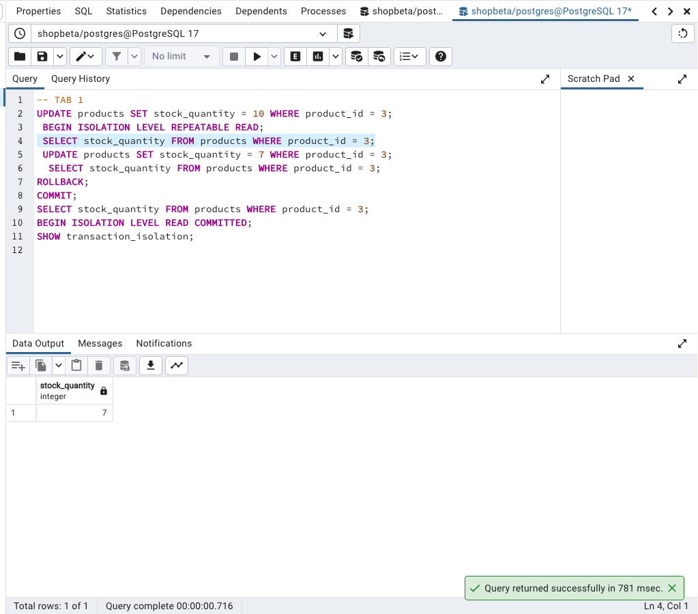
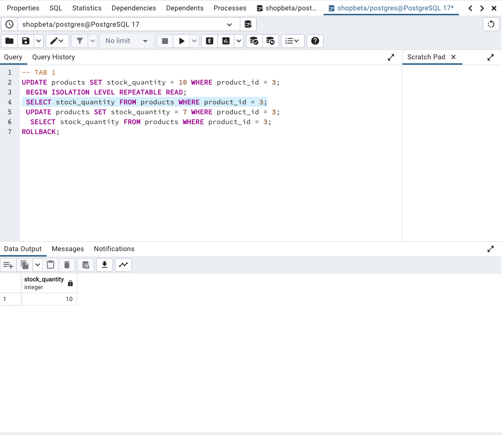

# Portfolio 3: Transactions and Concurrency

## 1. Purpose
This portfolio shows how transactions keep ShopBeta's data correct when an order is placed, when something fails, and when several customers act at the same time. All scripts are in `transactions_concurrency.sql`.

## 2. Successful transaction (COMMIT)
Placing an order involves several steps: create the order, add the items, reduce stock, record the payment and mark the order paid. All steps run inside one transaction.

- Orders before: 200000, after: 200001
- Stock of product 1 before: 10, after: 8



Executing COMMIT permanently saved every step of the checkout process—from creating the order to updating stock and recording the payment—into the database all at once. Because all six queries succeeded inside the transaction, the changes took effect together as a single complete unit without leaving any partial data behind.

## 3. Failed transaction (ROLLBACK)
I tried to buy 50 units when only 8 were in stock. The CHECK constraint rejected the stock update, so I rolled the transaction back.

Order count inside the open transaction, after the new order was inserted:


The stock update fails because it would make the stock negative:


Order count after ROLLBACK:


The order was inserted first, and the count went up to 200002 inside the transaction.
The stock update then failed.
ROLLBACK undid everything, so the count went back to 200001 and no half-finished order was left.

## 4. Concurrency problem: lost update

**Note:** I was not able to run this scenario with two simultaneous sessions in my environment, so this section is an explanation of how the problem occurs and how PostgreSQL controls it. It is not based on screenshots of my own two-session test.

### The scenario
Product 3 has 10 units in stock. Two customers each buy 1 unit at the same moment. The correct final stock is 8.

### What goes wrong without protection
1. Both transactions read the stock and see 10.
2. Each calculates 10 - 1 = 9.
3. The first saves 9. The second also saves 9, overwriting the first.
4. The final stock is 9, but two units were sold. One sale has been lost. This is called a lost update.

```sql
-- Transaction A and Transaction B both run:
BEGIN;
SELECT stock_quantity FROM products WHERE product_id = 3;   -- both see 10
UPDATE products SET stock_quantity = 9 WHERE product_id = 3;
COMMIT;
```

### How it is controlled: row locking
Adding `FOR UPDATE` to the read locks the product row:

```sql
BEGIN;
SELECT stock_quantity FROM products WHERE product_id = 3 FOR UPDATE;
UPDATE products SET stock_quantity = stock_quantity - 1 WHERE product_id = 3;
COMMIT;
```

The first transaction locks the row. The second waits until the first commits, then reads the new value (9) and saves 8. The final stock is correct.

### Trade-off
Locking makes customers buying the same product wait for each other, which can slow the system under heavy load. It trades correctness for speed.

## 5. Isolation levels

| Level | First read | Second read (same transaction) | Meaning |
|---|---|---|---|
| READ COMMITTED | 10 | 7 | Sees changes committed by others during the transaction |
| REPEATABLE READ | 10 | 10 | Keeps seeing the data as it was when the transaction started |




In the READ COMMITTED test, the stock read 10 at first and then 7 inside the same transaction, because the other tab had committed its change in between. In the REPEATABLE READ test, the second read stayed at 10 even though the other tab had changed the stock to 7, because the transaction kept the snapshot it started with. Only after COMMIT did the stock show 7.

For ShopBeta checkout I would use READ COMMITTED, which is PostgreSQL's default, together with row locking (`SELECT ... FOR UPDATE`) on the product being bought. This keeps checkout fast and always uses the latest stock figure, while the lock stops two customers from overwriting each other's purchase. REPEATABLE READ gives steadier reads, but when two customers update the same row it can fail with a conflict error that the application must retry, which adds complexity for a busy shop.

## 6. Conclusion
Transactions keep ShopBeta's data correct by making a group of steps, such as placing an order, either all succeed or all fail. The commit and rollback tests showed this: a successful order was saved as one unit, and a failed order was completely undone. The isolation level tests showed that READ COMMITTED lets a transaction see changes other transactions have committed, while REPEATABLE READ keeps a steady view until the transaction ends. Row locking with `SELECT ... FOR UPDATE` is the standard way to stop two customers overwriting each other's stock update, and its trade-off is that users have to wait, which can slow a busy system.
