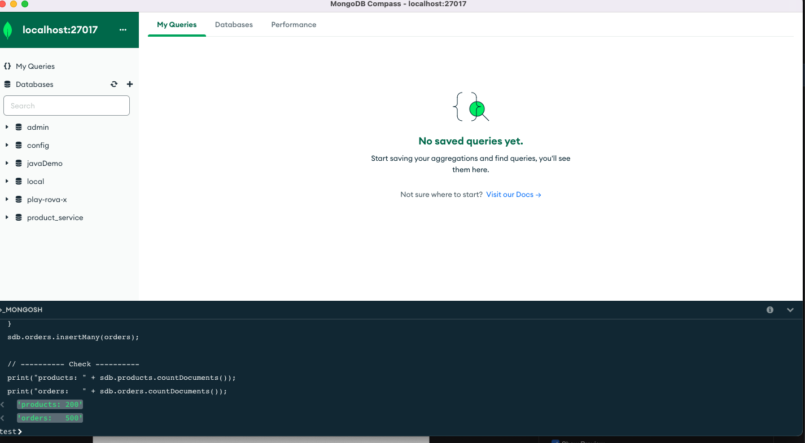
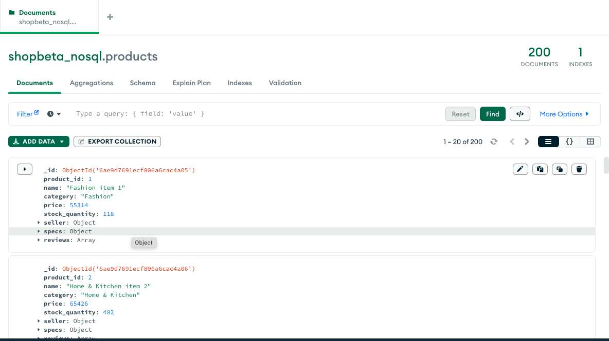
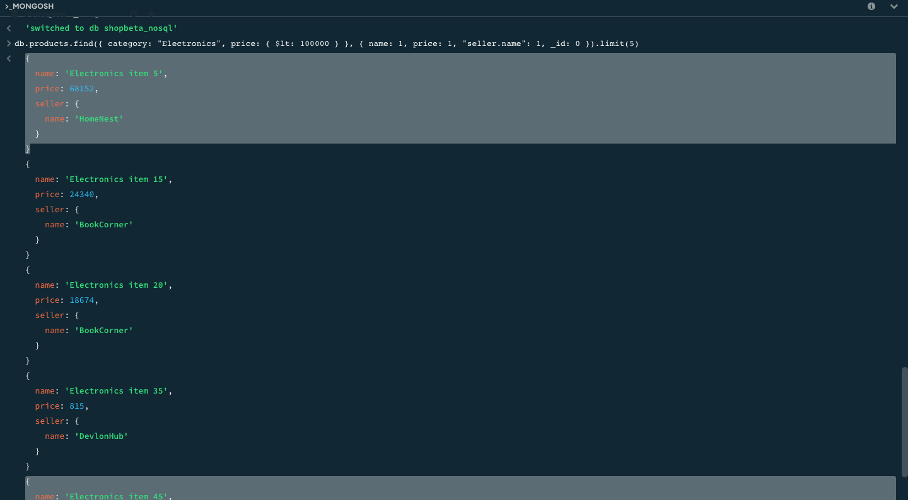
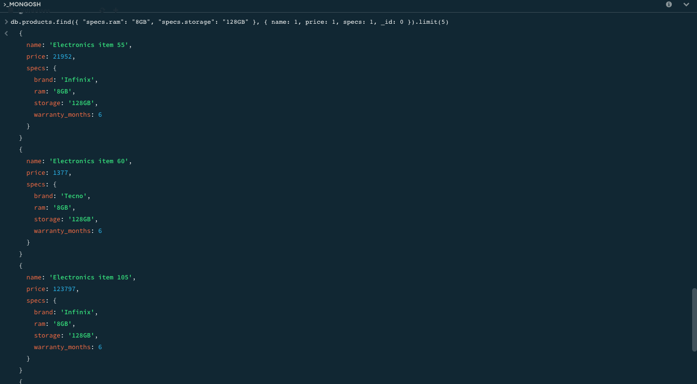
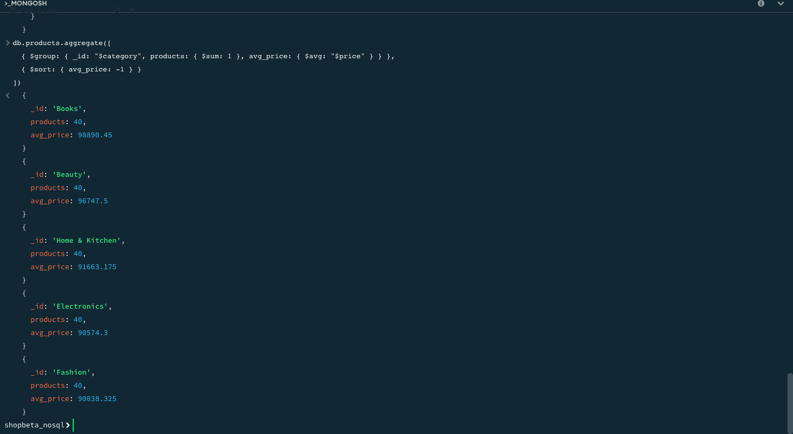
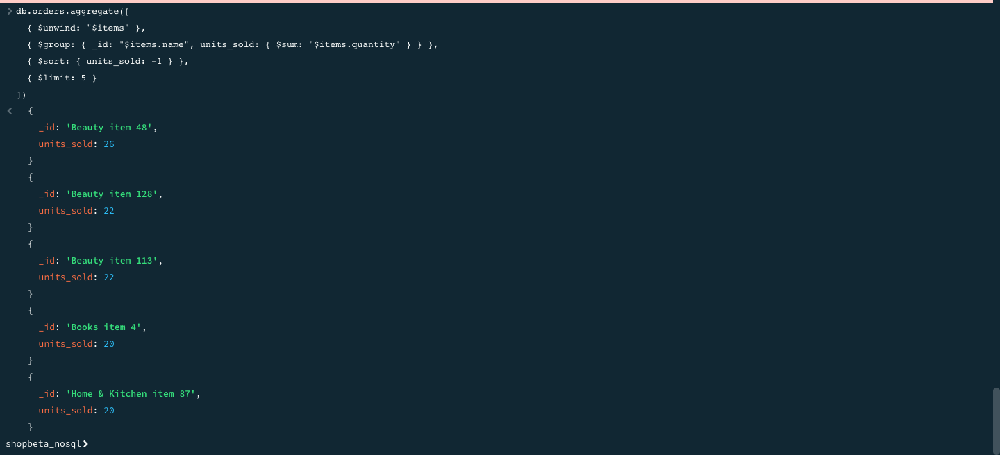
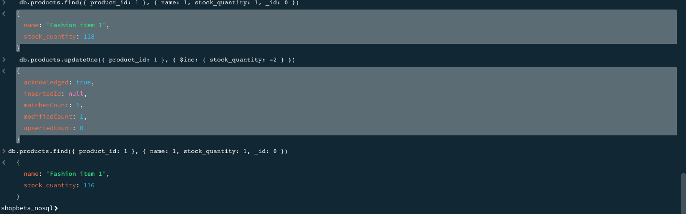
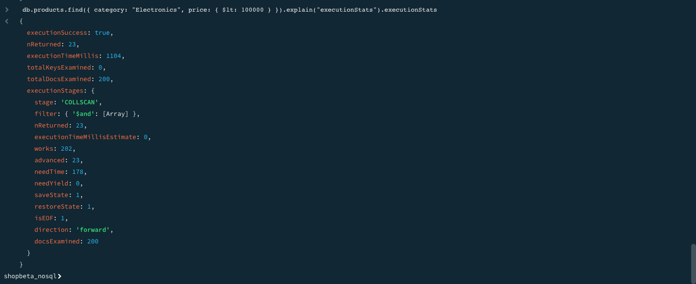
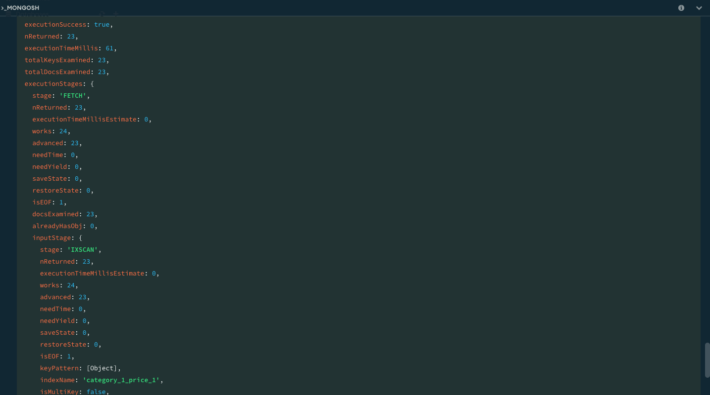

# Portfolio 4: NoSQL Modelling (MongoDB)

## 1. Why MongoDB for ShopBeta
ShopBeta sells products whose attributes differ by category: a phone has RAM and storage, a shirt has size and colour. In PostgreSQL this needs many NULL columns or extra tables. MongoDB is a document database, so each product stores only the fields it needs.

Tool: MongoDB 6.0.5 running locally, with MongoDB Compass and mongosh. Database: `shopbeta_nosql`. All data is synthetic and generated by `seed_data.js`.



## 2. Data model

**products collection (200 documents):** one document per product, with the seller embedded and the specs differing by category.

```json
{
  "product_id": 5,
  "name": "Electronics item 5",
  "category": "Electronics",
  "price": 68152,
  "stock_quantity": 120,
  "seller": { "name": "HomeNest", "city": "Ibadan" },
  "specs": { "brand": "Tecno", "ram": "8GB", "storage": "128GB", "warranty_months": 12 },
  "reviews": [ { "rating": 4, "comment": "Works well" } ]
}
```

**orders collection (500 documents):** one document per order, with the customer details and the items stored inside it.



## 3. Relational design compared with the document design

| Topic | PostgreSQL (Portfolios 1-3) | MongoDB (this portfolio) |
|---|---|---|
| Structure | Fixed columns in tables | Flexible documents in collections |
| Product attributes | Extra columns or tables | Different `specs` fields per document |
| Order items | Separate `order_items` table joined by keys | `items` array inside the order |
| Seller details | Separate `sellers` table | Embedded in each product |
| Integrity | Foreign keys and CHECK constraints | Not enforced by the database |
| Trade-off | No duplicated data, joins needed | Faster reads, some duplicated data |

PostgreSQL suits ShopBeta's orders, payments and stock, because these need strict rules and exact, consistent data, such as foreign keys, CHECK constraints and transactions. MongoDB suits the product catalogue, because products from different categories have different attributes and are mostly read, so storing each product as one flexible document is simpler and faster than joining several tables.

## 4. Queries

### Q1: Filter by category and price
```javascript
db.products.find({ category: "Electronics", price: { $lt: 100000 } }, { name: 1, price: 1, "seller.name": 1, _id: 0 }).limit(5)
```


### Q2: Search inside flexible specs
```javascript
db.products.find({ "specs.ram": "8GB", "specs.storage": "128GB" }, { name: 1, price: 1, specs: 1, _id: 0 }).limit(5)
```
Searches fields that only some products have.



### Q3: Average price per category
```javascript
db.products.aggregate([
  { $group: { _id: "$category", products: { $sum: 1 }, avg_price: { $avg: "$price" } } },
  { $sort: { avg_price: -1 } }
])
```


### Q4: Top 5 best-selling products
```javascript
db.orders.aggregate([
  { $unwind: "$items" },
  { $group: { _id: "$items.name", units_sold: { $sum: "$items.quantity" } } },
  { $sort: { units_sold: -1 } },
  { $limit: 5 }
])
```
`$unwind` splits each order's items so they can be counted without a join.



### Q5: Update stock
```javascript
db.products.updateOne({ product_id: 1 }, { $inc: { stock_quantity: -2 } })
```
Stock of product 1 went from 118 to 116.



## 5. Indexing

```javascript
db.products.find({ category: "Electronics", price: { $lt: 100000 } }).explain("executionStats").executionStats
```

| | Before index | After index |
|---|---|---|
| Stage | COLLSCAN | IXSCAN |
| Documents examined | 200 | 23 |
| Documents returned | 23 | 23 |

```javascript
db.products.createIndex({ category: 1, price: 1 })
```




COLLSCAN means MongoDB read every document in the collection to find the matches, which was all 200 documents here. IXSCAN means it used the index to go straight to the matching documents, so only the 23 products that matched were examined. Examining 23 documents instead of 200 is less work, and the gap grows as the collection gets bigger.

## 6. Conclusion
MongoDB suits ShopBeta's product catalogue because products from different categories have different attributes and can be stored as flexible documents, with sellers and reviews inside them. What is given up compared with PostgreSQL is the database enforcing rules, such as foreign keys and CHECK constraints, so the application has to protect the data, and some information is repeated across documents. An index still matters in MongoDB, because without one every query scans the whole collection, which gets slower as the data grows.
