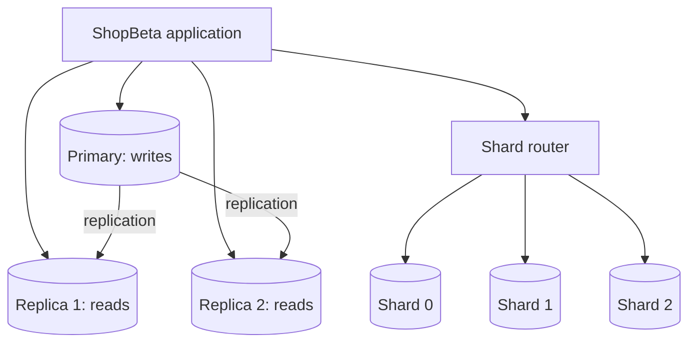

# Portfolio 5: Distributed and Cloud Database Exercise

## 1. Purpose
This portfolio explains how ShopBeta's database could be distributed and deployed in the cloud, covering replication, sharding, availability and consistency. The design is a discussion based on ShopBeta. A small partitioning demo on one server was run as practical evidence. No multi-server cluster was built.

## 2. Why ShopBeta needs a distributed design
ShopBeta is a marketplace with many customers browsing and buying at the same time, including during sales. A single database server is a single point of failure, and one server can only handle so much traffic. Distributing the data improves availability, read speed and room to grow.

## 3. Replication
Replication keeps copies of the database on several servers.

- **Design:** one primary server takes all writes (orders, payments, stock updates). Two replicas copy its changes and serve read traffic such as product browsing.
- **Benefits:** if the primary fails, a replica can take over, and read load is shared.
- **Trade-off:** with asynchronous replication, a replica can be a moment behind the primary, so a customer may briefly see an old stock number. Synchronous replication avoids this but makes writes slower.
- **Where it applies:** PostgreSQL supports streaming replication, and MongoDB uses replica sets (one primary and several secondaries).

## 4. Sharding
Sharding splits data across servers, with each server holding part of it.

- **Orders:** sharded by a hash of `customer_id`, so one customer's orders stay together and orders spread evenly. Customer "my orders" queries then go to a single shard.
- **Products:** sharded by `category` or `product_id`, or kept in one replicated collection, since the catalogue is small and mostly read.
- **Trade-offs:** queries without the shard key, such as total sales for the month, must ask every shard. Transactions that span shards are harder, and picking a poor shard key causes uneven load.

## 5. Availability and consistency
When servers cannot reach each other, a distributed system must choose between staying available and staying consistent (the CAP idea).

| ShopBeta area | Priority | Reason |
|---|---|---|
| Checkout, payments, stock updates | Consistency | Two customers must not buy the last unit (see the lost update in Portfolio 3) |
| Product catalogue and browsing | Availability | Slightly old data is acceptable, but the site must stay up |

So the checkout path reads from and writes to the primary, with transactions and row locking, while browsing can use replicas and accept eventual consistency.

## 6. Cloud deployment
ShopBeta could run on managed cloud databases, where the provider handles backups, patching and failover, for example a managed PostgreSQL service for orders and payments, and a managed MongoDB service such as MongoDB Atlas for the catalogue. Replicas would be placed in different availability zones, so one data-centre failure does not stop the shop. Backups and point-in-time recovery would protect against mistakes. Cost, latency and data-location rules should be checked before choosing a region.

## 7. Practical evidence: partitioning demo
A single PostgreSQL server cannot be truly sharded, but hash partitioning shows the same idea. A copy of the orders table was split into three partitions by a hash of `customer_id`. The script is in `partitioning_demo.sql`.

Rows per partition:

A query using the shard key only touched one partition:

The 200,000 orders were spread almost evenly, and the query for one customer read only one partition, which is what a good shard key should do. This was run on one server, so it demonstrates the data split but not separate machines, replication or failover.

## 8. Conclusion
ShopBeta would benefit from replication for availability and read capacity, and from sharding orders by customer as the data grows. Consistency matters most at checkout, while the catalogue can tolerate slightly old data. Distribution improves resilience and scale at the cost of more complexity.

## References
- PostgreSQL Global Development Group. PostgreSQL documentation: Table Partitioning, and High Availability, Load Balancing and Replication.
- MongoDB, Inc. MongoDB documentation: Replication, and Sharding.
